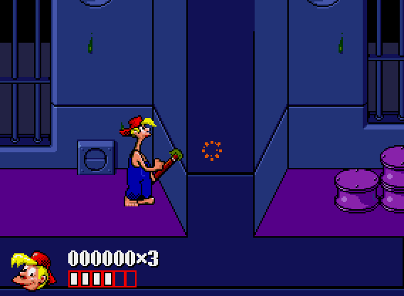
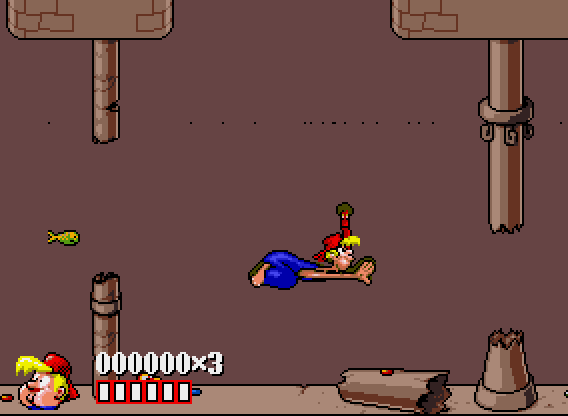
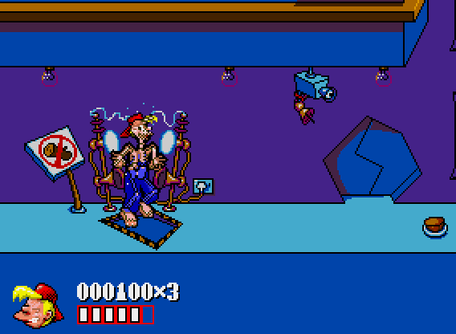

# Bubba 'n' Stix — remake Java

Remake fidèle du jeu Amiga **Bubba 'n' Stix** (Core Design, 1994), en Java pur.

Le dépôt ne contient **aucun fichier du jeu original**. Au premier lancement, le jeu extrait
lui-même les graphismes, les sons, les musiques et le code des deux disquettes, que vous devez
fournir.

<p align="center">
  
</p>

| | |
|---|---|
|  |  |
| **Niveau 1** : la forêt | **Niveau 2** : la prison |
|  |  |
| **Niveau 3** : la lave | **Niveau 4** : sous l'eau |
|  |  |
| **Niveau 5** : le laboratoire | **Niveau 5** : la cage électrique |

## Principe

Le jeu est reconstruit routine par routine à partir du désassemblage de l'exécutable original
(`Bubba`, 68000) :

1. **Extraction** (paquet `bubba.extract`). Le jeu lit les disquettes (système de fichiers
   AmigaDOS), décompresse les fichiers (RNC ProPack 1 et 2, SPAK, NoisePacker) et convertit tout
   en formats courants : PNG, WAV, MOD et JSON.
2. **Portage.** Chaque routine de l'exécutable original a été réécrite en Java : la boucle
   principale, Bubba et Stix, les objets, la caméra, la barre d'état, le démarrage des niveaux
   et le code propre à chaque niveau. Les routines s'appellent entre elles directement en Java.
3. **Vérification.** Un petit interpréteur 68000 (`bubba.cpu.M68k`) sert de référence pendant le
   développement : avec `-PverifyPorts`, chaque routine Java est rejouée sur le code original à
   partir du même état, et la mémoire et les registres sont comparés, image par image. Les cas
   rares sont testés par tirages au hasard (`bubba.dev.PortFuzz`).

### Avancement

**Tout ce que le jeu exécute est en Java** : en jeu comme au démarrage d'un niveau,
l'interpréteur n'exécute plus aucune instruction de l'original (mesuré par `bubba.dev.Coverage`
sur 15 000 images de jeu aléatoire et les 5 niveaux). Toutes les routines portées sont vérifiées
sans aucune différence avec l'original, y compris ses bizarreries, qui font partie du comportement
du jeu.

**Reste à faire** :
- les états internes du jeu (registres du 68000) sont encore représentés comme tels : le code
  Java suit l'original au plus près, il pourra être simplifié une fois la référence moins
  nécessaire.

## Jouer

1. **Télécharger le jeu** : l'archive de la [dernière release](../../releases) pour votre système
   (`BubbaNStix-<version>-windows-amd64.zip`...). Java est inclus : rien d'autre à installer.
2. **Les deux disquettes** du jeu original (format TOSEC) : le jeu propose de les télécharger
   lui-même au premier lancement ; sinon, sur Amiga Museum :
   - [Bubba 'n' Stix (1994)(Core)(Disk 1 of 2)[cr LTD].zip](https://amigamuseum.emu-france.info/Fichiers/ADF/B/Bubba%20'n'%20Stix%20(1994)(Core)(Disk%201%20of%202)%5bcr%20LTD%5d.zip)
   - [Bubba 'n' Stix (1994)(Core)(Disk 2 of 2)[cr LTD].zip](https://amigamuseum.emu-france.info/Fichiers/ADF/B/Bubba%20'n'%20Stix%20(1994)(Core)(Disk%202%20of%202)%5bcr%20LTD%5d.zip)
3. **Lancer** `BubbaNStix` (`BubbaNStix.exe` sous Windows).

Au premier lancement, le jeu cherche les disquettes (archives `.zip` ou images `.adf`) à côté de
l'application, dans le dossier courant et dans Téléchargements. S'il ne les trouve pas, il
propose de les **télécharger directement depuis Amiga Museum** (un clic), ou de les choisir à la
main. Il en extrait ses données en quelques secondes, une seule fois, dans le dossier
utilisateur :

| Système | Dossier |
|---|---|
| Windows | `%LOCALAPPDATA%\BubbaNStix` |
| macOS | `~/Library/Application Support/BubbaNStix` |
| Linux | `~/.local/share/bubbanstix` |

Les disquettes y sont aussi copiées (`disks/`), pour pouvoir refaire l'extraction sans les
redemander. Supprimer ce dossier remet le jeu à zéro.

## Développement

Prérequis : **JDK 21**. Gradle et son wrapper font le reste.

```
gradlew run                  # Linux / macOS : ./gradlew run
gradlew run -PverifyPorts    # chaque routine portée est comparée au code original, image par image
gradlew releaseZip           # application autonome (jpackage, JRE inclus) zippée dans build/distributions
gradlew jpackageImage -PinstallerType=msi   # installeur natif (msi/exe : WiX ; deb, rpm, dmg, pkg)
```

- **Données du jeu** : `gradlew run` utilise `../assets` s'il existe. Sinon, il passe par
  l'extraction du premier lancement décrite plus haut. `-Dbubba.assets=<dossier>` impose un
  dossier.
- **Release** : jpackage produit une application pour le système sur lequel il tourne. Pour
  publier Windows, macOS et Linux, il faut construire la release sur chacun d'eux, par exemple
  avec une CI.
- **Outils de développement** (`bubba.dev`) :
  - `ExtractCheck` compare l'extraction Java à un dossier `assets` de référence ;
  - `ReadmeShots` produit les captures d'écran de ce README ;
  - `EmuShot` et `PortFuzz` vérifient les portages.
- Le projet s'ouvre directement dans NetBeans, IntelliJ IDEA ou VS Code comme projet Gradle.

## Contrôles

| Touche | Action |
|---|---|
| Flèches / ZQSD / WASD | directions (joystick) |
| Espace / Ctrl / Entrée | feu |
| P | pause (une touche pour reprendre) |
| Échap | retour / quitter |
| F1–F4 | fenêtre ×1 à ×4 |
| F11 | plein écran |
| N | *(debug)* niveau suivant |
| B | *(debug)* affichage de debug |

## Organisation

```
src/main/java/bubba/
  extract/  extraction des disquettes : AmigaDOS, RNC ProPack, sons, musiques, images, niveaux
  engine/   fenêtre, boucle 50 Hz (VBL PAL), entrées, chargement des assets
  audio/    lecteur ProTracker, bruitages
  scenes/   écran titre, options, niveau
  level/    carte, blocs, parallaxe, placement des objets
  entity/   sprites, machines virtuelles d'animation et de comportement
  emu/      exécution de la boucle de jeu originale, barre d'état, sons
  game/     routines originales portées en Java (Ports = registre des portages)
  cpu/      interpréteur 68000 et mémoire (oracle de vérification)
  dev/      outils de développement : captures, couverture, fuzzing des portages
```

## Avertissement

Bubba 'n' Stix est © 1994 Core Design. Ce projet est un travail de préservation et
d'étude, sans but commercial, et n'est affilié ni à Core Design ni à ses ayants droit. Il ne
distribue aucune donnée du jeu : il faut fournir ses propres images de disquettes. Les captures
d'écran de ce README servent seulement à illustrer le projet.
