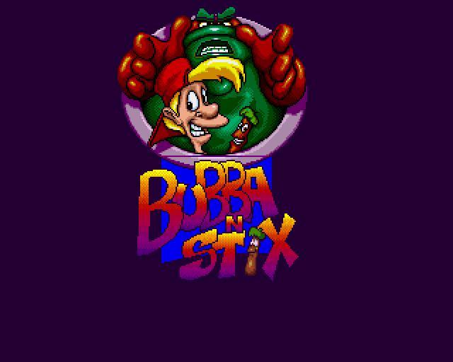
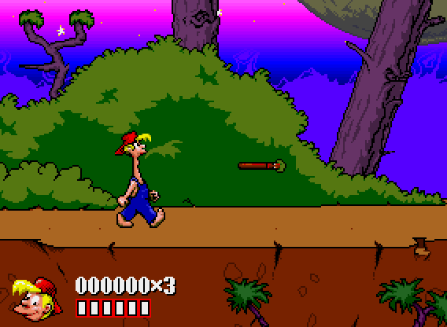
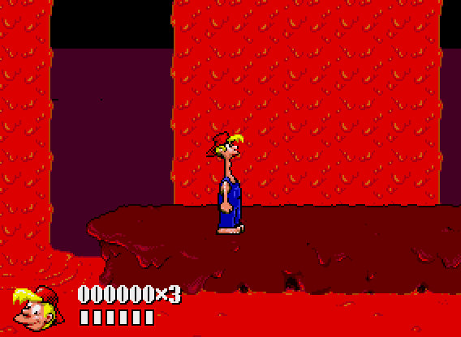
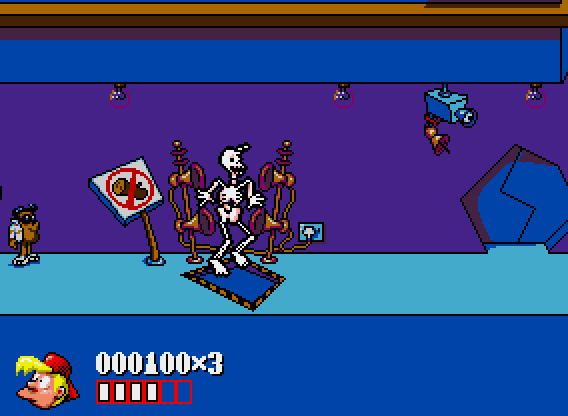

# Bubba 'n' Stix — Java remake

*[Version française](README_fr.md)*

Faithful remake of the Amiga game **Bubba 'n' Stix** (Core Design, 1994), in pure Java.

The repository contains **no files from the original game**. On first launch, the game itself
extracts the graphics, sounds, music and code from the two disks, which you must
provide.

<p align="center">
  
</p>

| | |
|---|---|
|  |  |
| **Stage 1**: the forest | **Stage 2**: the prison |
|  |  |
| **Stage 3**: the lava | **Stage 4**: underwater |
|  |  |
| **Stage 5**: the laboratory | **Stage 5**: the electric cage |

## How it works

The game is rebuilt routine by routine from the disassembly of the original executable
(`Bubba`, 68000):

1. **Extraction** (package `bubba.extract`). The game reads the disks (AmigaDOS file
   system), decompresses the files (RNC ProPack 1 and 2, SPAK, NoisePacker) and converts everything
   to common formats: PNG, WAV, MOD and JSON.
2. **Porting.** Every routine of the original executable has been rewritten in Java: the main
   loop, Bubba and Stix, the objects, the camera, the status bar, stage startup
   and each stage's own code. The routines call each other directly in Java.
3. **Verification.** A small 68000 interpreter (`bubba.cpu.M68k`) serves as a reference during
   development: with `-PverifyPorts`, each Java routine is replayed on the original code from
   the same state, and memory and registers are compared, frame by frame. Rare cases
   are tested by random sampling (`bubba.dev.PortFuzz`).

### Progress

**Everything the game executes is in Java**: in game as well as at stage startup,
the interpreter no longer executes a single instruction of the original (measured by `bubba.dev.Coverage`
over 15,000 frames of random play and the 5 stages). All ported routines are verified
with no difference from the original, including its quirks, which are part of the game's
behavior.

**Still to do**:
- the game's internal state (68000 registers) is still represented as such: the
  Java code follows the original as closely as possible; it can be simplified once the reference is less
  necessary.

## Playing

1. **Download the game**: the archive from the [latest release](../../releases) for your system
   (`BubbaNStix-<version>-windows-amd64.zip`...). Java is included: nothing else to install.
2. **The two disks** of the original game (TOSEC format): the game offers to download them
   itself on first launch; otherwise, from Amiga Museum:
   - [Bubba 'n' Stix (1994)(Core)(Disk 1 of 2)[cr LTD].zip](https://amigamuseum.emu-france.info/Fichiers/ADF/B/Bubba%20'n'%20Stix%20(1994)(Core)(Disk%201%20of%202)%5bcr%20LTD%5d.zip)
   - [Bubba 'n' Stix (1994)(Core)(Disk 2 of 2)[cr LTD].zip](https://amigamuseum.emu-france.info/Fichiers/ADF/B/Bubba%20'n'%20Stix%20(1994)(Core)(Disk%202%20of%202)%5bcr%20LTD%5d.zip)
3. **Run** `BubbaNStix` (`BubbaNStix.exe` on Windows).

On first launch, the game looks for the disks (`.zip` archives or `.adf` images) next to
the application, in the current folder and in Downloads. If it cannot find them, it
offers to **download them directly from Amiga Museum** (one click), or to pick them
by hand. It extracts its data from them in a few seconds, once only, into the user
folder:

| System | Folder |
|---|---|
| Windows | `%LOCALAPPDATA%\BubbaNStix` |
| macOS | `~/Library/Application Support/BubbaNStix` |
| Linux | `~/.local/share/bubbanstix` |

The disks are also copied there (`disks/`), so the extraction can be redone without asking
for them again. Deleting this folder resets the game.

## Development

Requirements: **JDK 21**. Gradle and its wrapper do the rest.

```
gradlew run                  # Linux / macOS: ./gradlew run
gradlew run -PverifyPorts    # each ported routine is compared to the original code, frame by frame
gradlew releaseZip           # standalone application (jpackage, JRE included) zipped into build/distributions
gradlew jpackageImage -PinstallerType=msi   # native installer (msi/exe: WiX; deb, rpm, dmg, pkg)
```

- **Game data**: `gradlew run` uses `../assets` if it exists. Otherwise, it goes through
  the first-launch extraction described above. `-Dbubba.assets=<folder>` forces a
  folder.
- **Release**: jpackage produces an application for the system it runs on. To
  publish for Windows, macOS and Linux, the release must be built on each of them, for example
  with a CI.
- **Development tools** (`bubba.dev`):
  - `ExtractCheck` compares the Java extraction against a reference `assets` folder;
  - `ReadmeShots` produces the screenshots in this README;
  - `EmuShot` and `PortFuzz` verify the ports.
- The project opens directly in NetBeans, IntelliJ IDEA or VS Code as a Gradle project.

## Controls

| Key | Action |
|---|---|
| Arrows / ZQSD / WASD | directions (joystick) |
| Space / Ctrl / Enter | fire |
| P | pause (any key to resume) |
| Esc | back / quit |
| F1–F4 | window ×1 to ×4 |
| F11 | full screen |
| N | *(debug)* next stage |
| B | *(debug)* debug display |

## Layout

```
src/main/java/bubba/
  extract/  disk extraction: AmigaDOS, RNC ProPack, sounds, music, images, stages
  engine/   window, 50 Hz loop (PAL VBL), input, asset loading
  audio/    ProTracker player, sound effects
  scenes/   title screen, options, stage
  level/    map, blocks, parallax, object placement
  entity/   sprites, animation and behavior virtual machines
  emu/      execution of the original game loop, status bar, sounds
  game/     original routines ported to Java (Ports = registry of ports)
  cpu/      68000 interpreter and memory (verification oracle)
  dev/      development tools: screenshots, coverage, port fuzzing
```

## Legal Notice & Game Assets

### Independent Engine Implementation

This project is an independent reimplementation of the *Bubba 'n' Stix* engine, designed to reproduce the original game's behavior on modern platforms.

The engine has been developed independently through technical analysis, reverse engineering (disassembly of the original 68000 executable), and compatibility testing. It does not include or redistribute the original game's proprietary source code.

### Original Game Files

This project requires original game files, such as the game's two disks (TOSEC `.zip` archives or Amiga ADF disk images), to run.

**Original game files are not included in this project.**

Users must obtain and provide their own game files from a legally authorized source. Before downloading or using this engine, users are required to confirm that they possess a legally obtained copy of the original game.

On first launch the game looks for the disks next to the application, in the current folder and in Downloads, or offers to download them from Amiga Museum; it extracts its data once into the user folder. The screenshots in this README only illustrate the project.

Eloane Studio does not host, distribute, or provide unauthorized copies of copyrighted game assets.

### Copyright & Trademarks

All original game names, trademarks, graphics, music, and other proprietary assets of *Bubba 'n' Stix* remain the property of their respective copyright holders (Core Design).

This project is an independent, unofficial implementation and is not affiliated with, endorsed by, or sponsored by the original game's developers or publishers.

### Preservation

The purpose of this project is to preserve the technical behavior and gameplay experience of classic video games while making them accessible on modern systems.

The engine is provided for compatibility, preservation, and educational purposes.

### Credits

Original game: Core Design (1994). Java remake: **Guillaume Monet**.
